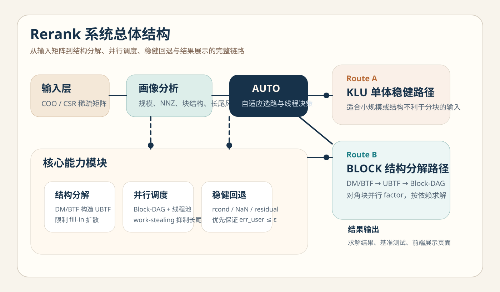
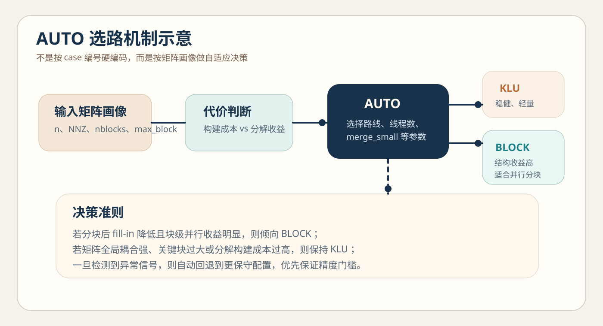
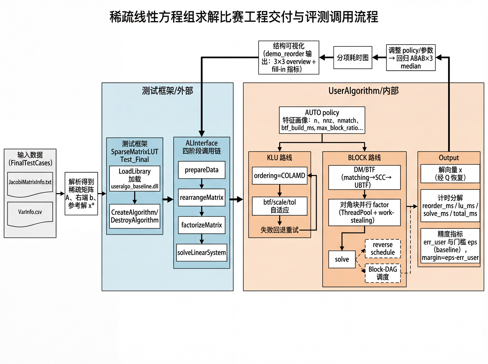
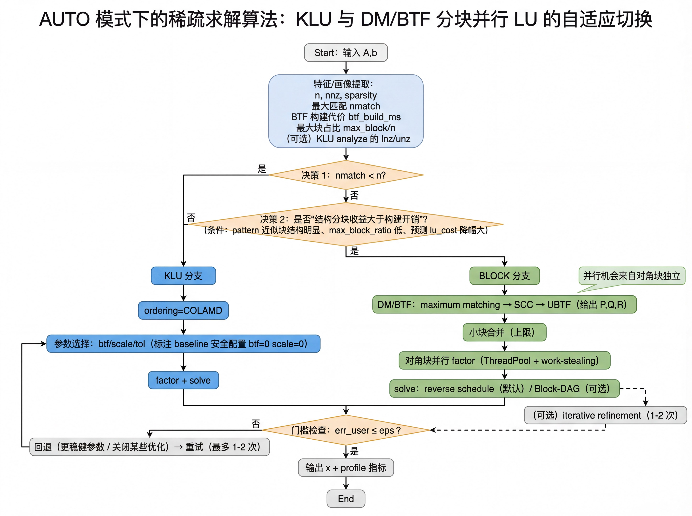
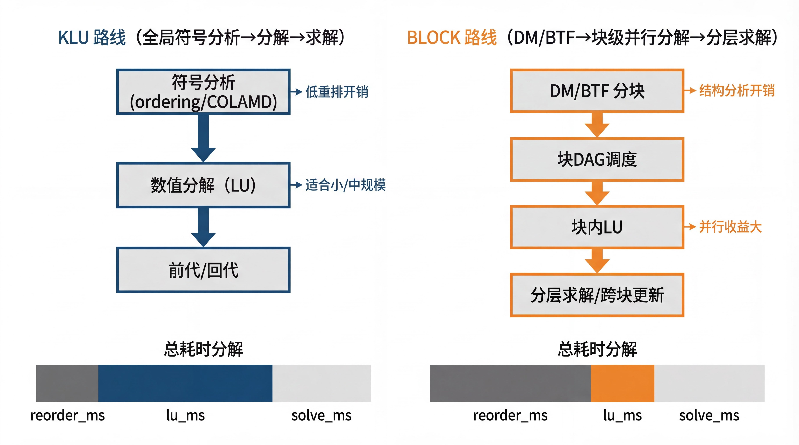
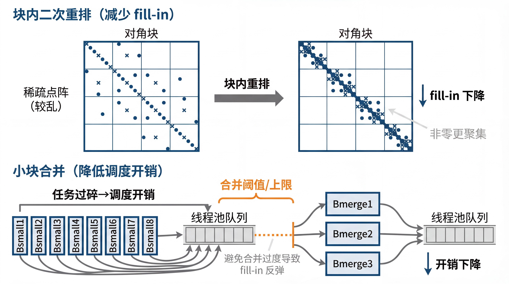
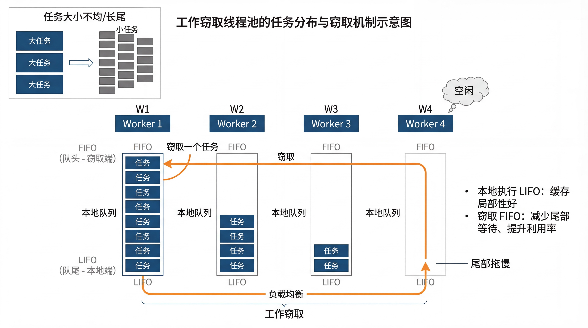
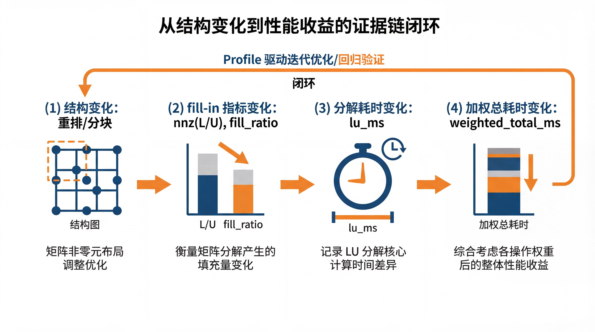
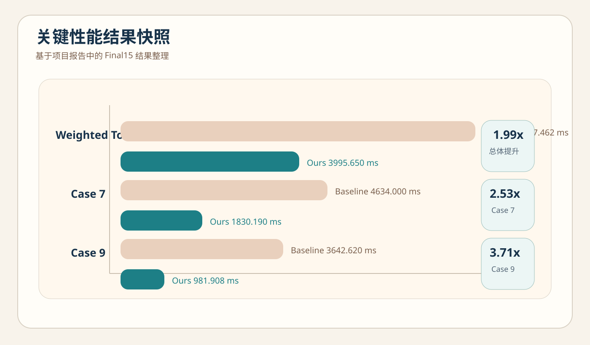

# 中国大学生计算机设计大赛

## 软件开发类作品文档

作品编号：待填写  
作品名称：Rerank——大规模稀疏线性方程组智能求解与展示系统  
作者：待填写  
版本编号：V1.0  
填写日期：2026年4月7日  

> 复现状态说明：文档中的 Final15 性能数字来自修复前的历史单轮记录。当前公开版本已改为重复测量、median/P95、数据校验和与机器元数据口径；正式结果将在私有 Final15 工作流复跑后更新。

---

## 目录

- 第一章 需求分析
- 第二章 概要设计
- 第三章 详细设计
- 第四章 测试报告
- 第五章 安装及使用
- 第六章 项目总结
- 参考文献

---

## 第一章 需求分析

### 1.1 项目背景

在化工流程模拟、科学计算、约束优化与工业仿真等场景中，求解大规模稀疏线性方程组 `Ax=b` 是最核心、最频繁的计算步骤之一。实际工程中，该类求解并非只执行一次，而是通常嵌入 Newton 迭代、参数求优和动态仿真中被反复调用。若底层仍采用“整体黑盒式”的稀疏 LU 求解方式，容易面临以下问题：

- 矩阵分解过程中的填充（fill-in）使时间与空间开销急剧增加
- 对角块分布不均导致关键路径过长，线程数提升不能有效转化为加速
- 某些矩阵结构全局耦合较强，盲目分块反而增加构建开销
- 面对病态或近奇异矩阵时，若缺少稳健回退策略，容易造成求解失败或误差超限

因此，本作品研发了 Rerank 系统，目标是在满足精度门槛的前提下，针对稀疏矩阵的结构特征进行自动分析和自适应调度，通过结构分解、并行执行与稳健回退机制提升整体求解性能，并配套构建一个前端展示界面，用于项目成果介绍、竞赛答辩和教学交流。

对于流程模拟类问题，可将求解过程简化表示为：

$$
J(x_k)\Delta x_k=-F(x_k),\qquad x_{k+1}=x_k+\Delta x_k,
$$

其中 $J(x_k)$ 是第 $k$ 次迭代时的雅可比矩阵。可见，稀疏线性方程组求解是上层非线性系统求解的核心基础能力。

### 1.2 行业现状与主要痛点

传统稀疏直接法在工程实践中已经非常成熟，但对于竞赛要求下的“高精度门槛 + 加权总耗时最优 + 可复现工程交付”，仍存在明显局限。具体表现如下：

1. 结构信息利用不足。许多现有方案更关注数值核本身，而忽略了矩阵结构可分性、最大块比例、跨块依赖等对整体耗时的决定性作用。
2. 并行能力不可解释。部分后端虽然内部支持并行，但对外部使用者而言，难以解释“为何某些输入快、某些输入慢”，更难以针对关键路径做调优。
3. 稳健性与性能耦合过强。若系统缺少统一的异常检测和回退策略，一旦遇到近奇异或高条件数矩阵，性能优化很可能以牺牲可用性为代价。
4. 展示与文档能力不足。很多高性能求解项目在算法层面较强，但缺少面向评委、用户和教学场景的统一展示能力，导致成果价值难以被快速理解。

从工程实现角度看，本题的核心不只是“把某一步做快”，而是建立一套可解释、可回归、可扩展的求解系统，让结构分析、性能收益、稳定性保障和项目展示形成完整闭环。

### 1.3 典型应用场景

本作品的设计并不是针对单一测试集临时构造，而是面向具有广泛代表性的稀疏线性系统求解场景。表 1 给出了典型应用场景与对应价值。

| 场景 | 问题特征 | 本作品价值 |
| --- | --- | --- |
| 化工流程模拟 | 矩阵规模大、局部耦合强、迭代求解频繁 | 通过结构分解降低 fill-in，并对大权重样本加速 |
| 科学计算教学与实验 | 需要直观理解矩阵结构、调度关系和性能差异 | 展示界面便于教学和答辩演示 |
| 并行计算研究 | 关注任务划分、关键路径和调度策略 | Block-DAG + work-stealing 提供良好实验平台 |
| 软件工程竞赛展示 | 不仅要结果，还需要完整作品形态 | 同时具备算法、测试、界面和文档 |

### 1.4 面向用户

本作品主要面向以下三类用户：

- 需要高效求解稀疏线性系统的科研与工程人员
- 数值计算、并行计算、软件工程方向的教师与学生
- 需要快速理解项目思路、技术亮点和性能结果的评审专家与答辩观众

除此之外，若后续进行工程推广，本作品也适合作为一个“面向稀疏求解的工程参考实现”，服务于需要将数值能力嵌入工业软件或科研原型系统的开发者。

### 1.5 主要功能与目标

本作品的主要功能如下：

1. 对输入稀疏矩阵进行画像分析，提取规模、非零元数量、块结构和长尾风险等特征
2. 在全局 KLU 路线与 BLOCK 分块路线之间进行自适应选路
3. 利用 DM/BTF 将矩阵转换为 UBTF 结构，并构建 Block-DAG
4. 通过线程池与 work-stealing 实现块级并行 factor 与 solve
5. 通过数值异常检测与回退机制保证精度门槛
6. 输出可复现实验结果，并通过前端展示页面统一呈现项目材料

本作品的总体优化目标可以概括为以下约束优化问题：

$$
\min T_{\text{weighted}}=\sum_{i=1}^{N} w_i\, t_i
\quad
\text{s.t.}
\quad
err_{user}\le \varepsilon,
$$

其中 $w_i$ 表示第 $i$ 个测试用例权重，$t_i$ 表示其总耗时，$\varepsilon$ 为基线方法给出的误差门槛。

围绕这一目标，本作品不仅关注最终总分，还同时追踪以下中间指标：

- 结构指标：块数量、最大块比例、可并行块集合
- 分解指标：fill-in、`decomp_ms`、数值分解成功率
- 求解指标：误差、残差、裕量
- 工程指标：构建成本、线程利用率、波动情况

### 1.6 需求分类

为了便于后续系统设计，本作品将需求拆分为功能性需求和非功能性需求两类。

#### 1.6.1 功能性需求

1. 系统应支持读取稀疏矩阵输入，并完成基础预处理。
2. 系统应支持根据输入矩阵特征自动选择求解路线。
3. 系统应支持 BLOCK 路线下的结构分解、块级并行 factor 与按依赖求解。
4. 系统应支持 KLU 路线下的稳健整体求解。
5. 系统应支持误差计算、门槛比较、失败检测与自动回退。
6. 系统应支持输出逐用例结果、汇总统计和图文展示材料。

#### 1.6.2 非功能性需求

1. 性能要求：在满足精度门槛的前提下尽量降低加权总耗时。
2. 稳定性要求：面对病态、近奇异、异常输入时不能静默失败。
3. 可解释性要求：能够说明收益来自哪些结构变化和哪些阶段优化。
4. 可扩展性要求：能够接入更多数值后端和更多调度策略。
5. 可部署性要求：支持脚本化构建与典型环境快速复现。
6. 可展示性要求：成果应适合答辩演示、作品介绍和教学场景使用。

### 1.7 对标作品与竞品分析

本作品不存在传统互联网意义上的商业竞品，但存在明确的技术对标对象：

- 对标 1：以 SuiteSparseWrapper / KLU 为代表的单体稀疏直接法基线
- 对标 2：仅更换数值后端、但不利用矩阵结构的通用稀疏求解方案

表 2 给出本作品与对标方案的对比。

| 表 2 竞品/对标分析 | 基线/通用方案 | 本作品 |
| --- | --- | --- |
| 结构利用方式 | 将矩阵整体处理，结构不显式 | DM/BTF 分解后形成 UBTF 与 Block-DAG |
| 并行能力来源 | 依赖底层库内部并行，不易控制 | 块级并行 + work-stealing 调度 |
| 选路方式 | 固定流程或人工调参 | AUTO 按矩阵画像自适应决策 |
| 稳健性 | 缺少统一的回退闭环 | 通过信号检测触发稳健回退 |
| 可解释性 | 难以说明为何快或为何慢 | 建立结构、fill-in、耗时之间的证据链 |
| 展示能力 | 以命令行和报告为主 | 增加项目展示页面，适合答辩与演示 |

从对标结果可以看出，本作品的优势不只体现在单一速度指标上，而是体现在“结构驱动 + 调度优化 + 工程稳健 + 统一展示”这四个维度的组合能力。

### 1.8 核心性能指标

本作品重点关注以下性能指标：

- 精度门槛：是否满足 $err_{user}\le \varepsilon$
- 加权总耗时：是否显著降低 $\sum w_i t_i$
- 单用例加速比：是否在权重大、规模大的样本上获得稳定收益
- 扩展性与复现性：是否支持脚本化构建、批量复现与二次集成

根据修复前的历史记录，Rerank 在 Final15 上全部满足精度门槛，加权总耗时由 `7937.462 ms` 降至 `3995.650 ms`，总体提升约 `1.99x`。该数字等待当前版本按新口径复跑确认。

图 1 给出了本作品的总体结构。



### 1.9 可行性与应用价值

本作品具备较强的技术可行性和应用价值，主要体现在以下方面：

- 技术来源可靠：建立在稀疏直接法、DM/BTF、KLU 等成熟理论和工程组件基础之上。
- 实现路径清晰：核心算法、线程池、调度器、兼容接口和展示界面都已落地到仓库中。
- 结果具有说服力：Final15 的整体加速和典型 case 的显著收益说明方案有效。
- 展示能力完善：项目不止是算法实现，更形成了完整的作品形态，适合竞赛提交与后续迭代。

---

## 第二章 概要设计

### 2.1 设计目标与原则

为了使作品既能满足竞赛技术指标，又具备较强的工程完整性，本作品在概要设计阶段明确了以下原则：

1. 先结构、后数值。优先挖掘矩阵结构带来的全局收益，再考虑块内数值核选择。
2. 先稳健、后提速。任何性能优化均以不突破精度门槛为前提。
3. 先解释、后堆料。每一项优化都需要能够回溯到结构变化、fill-in 变化或关键路径缩短。
4. 先交付、后扩展。项目既要可比赛提交，也要为后续开源、教学和二次开发保留接口。

### 2.2 总体架构

本作品采用“求解引擎 + 展示界面”的双层结构。底层是 BlockDAGLU 稀疏求解框架，上层是面向竞赛展示的项目展示界面。求解引擎负责矩阵分析、结构分解、并行调度和稳健回退；展示界面负责对项目背景、技术路线、性能结果和材料入口进行统一呈现。

图 2 展示了系统的 AUTO 选路机制。



从功能角度看，系统整体流程如下：

$$
\text{Input}\rightarrow \text{Profile}\rightarrow \text{AUTO}
\rightarrow
\begin{cases}
\text{KLU 路线}\\
\text{BLOCK 路线}
\end{cases}
\rightarrow \text{Factor / Solve}\rightarrow \text{Check / Fallback}\rightarrow \text{Output}.
$$

### 2.3 功能模块划分

| 模块 | 主要职责 |
| --- | --- |
| 输入与预处理模块 | 读取 COO / CSR 数据，完成初步检查 |
| 画像分析模块 | 提取规模、NNZ、连通性、块结构、长尾风险等特征 |
| AUTO 决策模块 | 在 KLU 与 BLOCK 之间选路，并给出线程和参数建议 |
| 结构分解模块 | 执行 DM/BTF，构造 UBTF 与块边界 |
| 并行调度模块 | 构建 Block-DAG，执行并行 factor 和按依赖求解 |
| 稳健回退模块 | 对 rcond、pivot growth、NaN/Inf、残差等信号做检测 |
| 测试统计模块 | 输出 runs.csv、margin.csv 和 summary.txt 等结果文件 |
| 展示界面模块 | 图文展示项目背景、技术路线、性能结果和材料入口 |

### 2.4 模块层次与调用关系

从层次结构来看，本作品可以划分为四层：

1. 展示层：展示页面与项目说明文档
2. 应用层：测试脚本、报告整理、结果汇总
3. 核心算法层：AUTO、DM/BTF、UBTF、Block-DAG、KLU/BLOCK 求解
4. 支撑层：线程池、缓存、动态库加载和构建脚本

各模块之间的关系可以概括为：展示层不直接参与数值求解，但调用应用层输出的数据；应用层通过核心算法层产生结果；支撑层为核心算法层提供基础运行能力。

### 2.5 业务流程与典型用例

从用户视角看，本作品至少包含以下几类典型用例：

| 用例编号 | 用例名称 | 输入 | 输出 |
| --- | --- | --- | --- |
| UC-01 | 求解单个稀疏线性系统 | 稀疏矩阵与右端项 | 解向量、误差与残差 |
| UC-02 | 对 15 个用例进行批量基准测试 | 数据集与脚本参数 | 分 case 结果、加权总耗时 |
| UC-03 | 查看项目成果展示页面 | 浏览器访问页面 | 项目介绍、图表、材料入口 |
| UC-04 | 作为库集成到其他工程 | C++ API 与矩阵数据 | 可复用的求解能力 |

系统的业务流程可以归纳为：

1. 用户准备矩阵数据或数据集。
2. 系统完成输入解析和画像分析。
3. AUTO 选择求解路线并配置线程与关键参数。
4. 求解引擎完成 factor / solve，并进行误差检查。
5. 结果被输出到文件、控制台或展示界面中。

### 2.6 核心数据流设计

为了保证方案的可解释性，本作品在概要设计阶段就明确了核心数据流：

$$
A,b \rightarrow \text{Profile} \rightarrow \text{Route Decision}
\rightarrow \text{Factorization} \rightarrow \text{Solve}
\rightarrow \text{Metrics} \rightarrow \text{Visualization}
$$

该数据流的设计意义在于：

- 前半段负责做出正确的结构化决策
- 中间阶段负责完成高效且稳健的求解
- 后半段负责把结果转化为可复现实验和可展示材料

### 2.7 人机界面概述

本作品包含两类交互界面：

- 命令行界面：用于构建、测试、基准对比和结果导出
- 前端展示界面：用于浏览项目介绍、技术路线、性能结果和项目材料

前端展示界面主要包含以下页面区域：

- 首页总览：项目定位、核心指标、总体判断
- 技术路线区：展示 Input、Profile、AUTO、KLU、BLOCK 等链路
- 性能结果区：提供 15 个测试用例的交互筛选和对比
- 图集区：展示系统流程图、算法流程图和证据链
- 材料区：提供 PDF、Markdown、README 和源码入口

### 2.8 部署与运行架构

在部署层面，本作品支持三种使用形态：

1. 作为竞赛兼容项目运行，生成 DLL 并接入测试框架。
2. 作为核心求解库集成到其他 C++ 工程中。
3. 作为静态展示站进行项目成果介绍和答辩演示。

这种设计使得项目不局限于“比赛代码仓库”，而具备更完整的软件作品形态。

---

## 第三章 详细设计

### 3.1 界面设计

本作品新增了一个静态展示界面，文件位于 `showcase/index.html`。该界面采用分区式信息展示设计，整体风格强调“技术型、结构化、可讲解”，重点体现以下原则：

- 首页突出项目核心论断，强调“不是简单换库，而是前端结构重构”
- 使用矩阵结构对比、策略筛选和指标卡片增强展示效果
- 将抽象算法拆解成易理解的流程区块，便于答辩讲解
- 通过项目材料入口打通 PDF、Markdown 和源码模块

#### 3.1.1 首页与总览区设计

首页承担“30 秒讲清作品”的任务，因此采用大标题、核心指标卡片和结论性文案结合的方式，重点突出以下信息：

- 作品主题：大规模稀疏线性方程组求解
- 技术主线：结构分解、填充控制、并行调度
- 历史结果摘要：Final15 全部过门槛，加权总耗时 1.99x 提升（等待当前版本复跑）

#### 3.1.2 技术路线区设计

技术路线区采用流程图和双路线卡片设计，让评委或用户可以快速理解：

- 输入矩阵先进入画像分析
- AUTO 决定走 KLU 或 BLOCK
- BLOCK 路线下由 DM/BTF 生成 UBTF，再进入 Block-DAG 调度

#### 3.1.3 性能结果区设计

性能结果区支持按策略类型和排序方式筛选 15 个测试用例。设计该模块的目的不是单纯展示总分，而是让用户看到：

- 哪些 case 适合 BLOCK
- 哪些 case 更适合 KLU
- 加速比与权重之间的关系
- 结构收益与构建成本之间的平衡

#### 3.1.4 材料入口区设计

为了让展示页具备文档门户属性，材料入口区统一汇聚了：

- 技术报告 PDF
- 路演讲稿
- 答辩问答
- README 与架构文档
- 核心源码入口

这一设计使展示页面同时具备“展示”和“索引”两种能力。

图 3 至图 5 展示了系统流程与算法流程的核心素材。







### 3.2 数据组织设计

本作品不是互联网业务系统，不依赖关系数据库，因此无传统业务数据库表设计。系统主要处理的数据对象是矩阵、块结构、调度依赖和测试结果，其组织方式如表 2 所示。

| 表 2 数据组织方式 | 存储形式 | 说明 |
| --- | --- | --- |
| 输入矩阵 | COO / CSR / CSC | 同时服务结构分析与数值分解 |
| 分解结果 | UBTF、P/Q、块边界 R | 支撑 BLOCK 路线 |
| 任务依赖 | Block-DAG 邻接关系 | 支撑并行调度 |
| 测试结果 | CSV / TXT | 支撑复现实验与性能分析 |
| 展示内容 | HTML / CSS / JS / 图片 / Markdown / PDF | 支撑项目演示与材料浏览 |

#### 3.2.1 稀疏格式设计

本作品同时使用 COO、CSR 和 CSC 三类稀疏格式，其设计原因如下：

- COO：适合作为通用输入格式，便于构建和调试
- CSR：适合按行访问和求解阶段的部分处理
- CSC：适合列重排和部分稀疏 LU 相关操作

这种多格式协同设计并不是冗余，而是为了在“结构分析”和“数值分解”两个阶段都尽量降低数据搬运成本。

#### 3.2.2 分块结果设计

在 BLOCK 路线中，系统会生成以下核心结果：

- 置换矩阵对应的行列映射 `P/Q`
- 块边界数组 `R`
- 对角块局部数据
- 跨块依赖关系 `block_deps / block_preds`
- 分层调度信息 `block_level / blocks_by_level`

这些数据共同构成了 Block-DAG 的物理基础。

#### 3.2.3 无数据库设计说明

本作品不采用传统关系数据库，原因在于：

1. 系统核心任务是高性能数值计算，处理对象为矩阵与计算结果，而非事务型业务数据；
2. 所有关键数据都可通过文件、内存结构和导出结果进行组织；
3. 对于竞赛场景而言，轻量、可复现、无外部依赖比引入数据库更重要。

### 3.3 核心类与接口设计

为了保证系统具备可维护性，本作品在代码层面对核心职责进行了拆分。表 3 给出了主要实现模块与文件位置。

| 表 3 核心实现模块 | 典型文件 | 作用说明 |
| --- | --- | --- |
| 求解总控 | `blockdaglu/include/blockdaglu/solver.h` | 统一封装 `set_matrix / analyze / factor / solve_in_place` 生命周期 |
| AUTO 与缓存逻辑 | `blockdaglu/src/solver.cpp` | 完成矩阵画像、选路、线程选择、缓存与全局流程控制 |
| 分块求解器 | `blockdaglu/src/ubtf_block_solver.h` | 承载 DM/BTF 分解结果、块因子和 BLOCK 路线核心接口 |
| 线程池 | `blockdaglu/src/thread_pool.h` | 提供 work-stealing 并行执行能力 |
| 竞赛兼容层 | `blockdaglu/include/UserAlgorithmWrapper.h` | 兼容比赛工具链调用接口 |

#### 3.3.1 求解器生命周期设计

核心求解器遵循以下生命周期：

1. `set_matrix`：写入矩阵，清理旧状态
2. `analyze`：推断规模、生成签名、完成 AUTO 选路和结构分析
3. `factor`：执行数值分解或块内 factor
4. `solve_in_place`：对右端项进行求解，输出解向量

这种分阶段设计与竞赛工具链的调用习惯保持一致，也便于做阶段级计时和优化归因。

#### 3.3.2 展示界面前端结构

展示页面由 `index.html`、`styles.css` 和 `app.js` 三部分组成：

- `index.html`：负责信息架构与内容骨架
- `styles.css`：负责版式、视觉风格和响应式布局
- `app.js`：负责渲染测试数据、筛选 case 和切换详情面板

### 3.4 关键算法设计

在详细设计层面，本作品不只关注“用了什么算法”，还关注“算法怎样和工程架构耦合”。因此，本节分别从结构分解、依赖建模、自适应选路、稳健回退和性能工程五个角度进行说明。

#### 3.3.1 DM/BTF 结构分解

DM/BTF 是本作品最关键的结构化处理手段之一。其目标是利用矩阵非零模式的结构信息，将原始问题转换成块上三角形式：

$$
P A Q =
\begin{bmatrix}
A_{11} & A_{12} & \cdots & A_{1k}\\
0 & A_{22} & \cdots & A_{2k}\\
\vdots & \ddots & \ddots & \vdots\\
0 & 0 & \cdots & A_{kk}
\end{bmatrix},
$$

其中 $P,Q$ 为置换矩阵，$A_{ii}$ 为对角块，非对角项只出现在上三角区域。经过这一变换后，原始矩阵的结构被显式化为“多个对角块 + 跨块依赖”，为后续并行 factor 与依赖求解打下基础。

图 6 展示了块内重排与合并相关的工程设计。



从实现逻辑上看，DM/BTF 主要包含三步：

1. 最大匹配，判断结构可分性和结构满秩情况；
2. 强连通分量划分，将强耦合区域收敛到对角块；
3. 根据块边界重排形成 UBTF，并为后续调度生成结构索引。

#### 3.3.2 Block-DAG 并行调度

在 UBTF 结构上，可将每个对角块视为图节点，将跨块上三角关系视为依赖边，于是得到块级依赖图：

$$
G=(V,E), \qquad
V=\{B_1,B_2,\dots,B_k\},
$$

若块 $B_i$ 的求解依赖于块 $B_j$ 的结果，则有边 $(B_j,B_i)\in E$。基于该图，本作品通过线程池与 work-stealing 机制执行任务并行：

- 本地 worker 优先处理本队列任务，保持缓存局部性
- 空闲 worker 可从其他队列窃取任务，缓解大块拖尾
- 对关键路径上的大块给予更高优先级，缩短整体完成时间

图 7 展示了 work-stealing 线程池的执行示意。



进一步地，若块 $B_i$ 的估计代价记为 $c_i$，则整体关键路径长度近似由下式主导：

$$
L_{\text{critical}}=\max_{\mathcal{P}\in \text{Path}(G)} \sum_{B_i\in \mathcal{P}} c_i.
$$

这也是本作品强调“关键路径意识”的原因：并行提速的上限并不由线程数直接决定，而主要由最长依赖链决定。

#### 3.3.3 AUTO 自适应选路

本作品不会对某一个 case 编号做硬编码，而是依据矩阵画像做决策。可将该过程抽象为：

$$
\pi(A)=
\arg\min_{m\in\{\text{KLU},\text{BLOCK}\}}
\widehat{T}(m\,|\,A)
\quad
\text{s.t.}
\quad
err(m,A)\le \varepsilon,
$$

其中 $\widehat{T}(m\,|\,A)$ 表示方法 $m$ 在矩阵 $A$ 上的预估耗时。若分块收益足以覆盖构建成本，则选择 BLOCK；若矩阵全局耦合强或关键块过大，则保留 KLU 路线。

AUTO 决策使用的特征主要包括：

- `n`：矩阵维度
- `nnz`：非零元数量
- `nblocks`：分块数量
- `max_block / n`：最大块占比
- `diag_cov`：对角覆盖情况
- `row_p95 / col_p95`：稀疏连接广度信号

这些特征不是为了构建复杂黑盒模型，而是为了支撑低开销、可解释的工程选路。

#### 3.3.4 精度检测与稳健回退

本作品将精度门槛视为硬约束。误差定义为：

$$
err(x)=\frac{\|x-x^\ast\|_2}{\|x^\ast\|_2},
$$

其中 $x^\ast$ 为参考解。定义误差裕量为：

$$
margin=\varepsilon-err_{user}.
$$

当检测到分解失败、`NaN/Inf`、条件数恶化或裕量收窄等情况时，系统将切换到更保守的参数或回退到稳健路径，优先保证最终满足 $err_{user}\le \varepsilon$。

此外，本作品还监控相对残差：

$$
rel\_residual(x)=\frac{\|b-Ax\|_2}{\|b\|_2},
$$

从而识别“残差虽小但与参考解偏差较大”的特殊情况，增强对病态矩阵的诊断能力。

#### 3.3.5 缓存、内存复用与动态加载

为了降低非必要开销，本作品在工程层面还做了以下设计：

1. 使用矩阵签名对结构分解和 KLU symbolic 结果做有界缓存。
2. 通过线程池复用 worker，避免频繁创建和销毁线程。
3. 使用动态加载边界接入 KLU / BTF 等后端，兼顾交付风险与可插拔扩展。
4. 在部分流程中通过轻量 profile 代替完整昂贵分析，降低选路成本。

#### 3.3.6 性能优化策略总结

从软件工程角度看，本作品的性能优化并非单点优化，而是一个组合策略：

- 结构层：减少 fill-in，缩短关键路径
- 调度层：提高就绪任务利用率，抑制长尾
- 参数层：按画像调整路线、线程数和 KLU 参数
- 系统层：利用 P/E 核感知和功耗策略改善尾部抖动
- 展示层：把性能结果组织成可复现实验和可讲解素材

#### 3.3.7 结构到性能的证据链

本作品并不只报告“快了多少”，而是尝试建立从结构变化到性能变化的解释链：

$$
\text{Structure}
\rightarrow
\text{fill-in}
\rightarrow
\text{decomp\_ms}
\rightarrow
T_{\text{weighted}}.
$$

图 8 展示了这一证据链。



### 3.5 技术创新总结

本作品的核心技术创新可以归纳为以下四点：

1. 利用 DM/BTF 对稀疏矩阵进行结构显式化，而非将矩阵整体作为黑盒处理
2. 基于 Block-DAG 与 work-stealing 实现块级并行调度，重点压缩关键路径和长尾块
3. 使用 AUTO 基于画像自适应选择求解路线与线程策略，减少人工调参成本
4. 建立精度检测与稳健回退机制，在性能提升前提下保证精度门槛稳定通过

---

## 第四章 测试报告

### 4.1 测试目标与策略

测试阶段的目标不是简单证明“程序能跑”，而是从多维度验证系统的工程质量。具体来说，本作品测试关注：

- 正确性：能否完成完整求解流程，输出合法结果
- 精度：能否稳定满足门槛要求
- 性能：能否在目标数据集上降低加权总耗时
- 稳定性：是否在多轮测试和复杂输入下保持行为一致
- 可部署性：是否便于构建、运行、展示和二次集成

围绕以上目标，本作品制定了“功能验证 + 性能回归 + 稳定性观察 + 人工展示验收”的组合测试策略。

### 4.2 测试环境

根据项目构建与运行文档，本作品的主要测试环境如下：

| 表 4 测试环境 | 配置 |
| --- | --- |
| 操作系统 | Windows |
| 编译环境 | Visual Studio 2022 / MSVC |
| 构建工具 | CMake 3.20+ |
| 运行依赖 | KLU、BTF、AMD、COLAMD 等动态库 |
| 数据集 | 私有 Final15，通过校验安装脚本部署到 `data/FinalTestCases/1~15` |
| 运行方式 | 脚本化构建与基准测试 |

### 4.3 功能测试

功能测试主要覆盖以下内容：

| 表 5 功能测试样例 | 测试内容 | 预期结果 | 实际结果 |
| --- | --- | --- | --- |
| FT-01 | 读取输入矩阵并建立求解器状态 | 可正常执行 `set_matrix` | 通过 |
| FT-02 | 对单个矩阵执行 `analyze` | 能完成画像分析和路线选择 | 通过 |
| FT-03 | 执行 `factor` 和 `solve_in_place` | 输出合法解向量 | 通过 |
| FT-04 | 批量运行 Final15 数据集 | 生成逐用例与汇总结果文件 | 通过 |
| FT-05 | 打开展示页面并切换 case 筛选 | 页面能正常显示与交互 | 通过 |
| FT-06 | 打开技术报告、讲稿和答辩材料链接 | 能正确跳转对应文件 | 通过 |

### 4.4 测试方法与指标定义

本作品在性能与精度测试中使用以下指标：

加权总耗时定义为：

$$
T_{\text{weighted}}=\sum_{i=1}^{15}w_i\,t_i.
$$

加速比定义为：

$$
S=\frac{T_{\text{baseline}}}{T_{\text{ours}}}.
$$

对于某一用例的耗时下降比例，可表示为：

$$
R=\frac{T_{\text{baseline}}-T_{\text{ours}}}{T_{\text{baseline}}}\times 100\%.
$$

### 4.5 关键测试结果

图 9 给出了本作品的关键性能快照。



表 6 汇总了最具代表性的结果。

| 表 6 关键测试结果 | 基线 | 本作品 | 结果 |
| --- | --- | --- | --- |
| 历史 Final15 加权总耗时 | 7937.462 ms | 3995.650 ms | 1.99x（待复跑） |
| Case 7 总耗时 | 4634.000 ms | 1830.190 ms | 2.532x |
| Case 9 总耗时 | 3642.620 ms | 981.908 ms | 3.710x |
| 精度门槛 | `err_user ≤ ε` | 全部满足 | 15/15 通过 |

### 4.6 Final15 分 case 测试结果

为了使测试结果更完整，表 7 给出 Final15 的主要统计数据。这里保留了默认策略、规模、权重、基线耗时、本作品耗时和加速比，便于从“整体”和“单用例”两个维度理解收益来源。

| 表 7 Final15 分 case 结果 | n | nnz | weight | strategy | baseline(ms) | ours(ms) | speedup |
| --- | ---: | ---: | ---: | --- | ---: | ---: | ---: |
| case1 | 8226 | 94723 | 0.10 | KLU | 28.176 | 16.538 | 1.704 |
| case2 | 8392 | 98146 | 0.10 | KLU | 27.573 | 18.277 | 1.509 |
| case3 | 17033 | 389381 | 0.10 | KLU | 159.192 | 97.516 | 1.632 |
| case4 | 19698 | 718507 | 0.10 | BLOCK | 385.355 | 122.430 | 3.148 |
| case5 | 37979 | 1045703 | 0.15 | KLU | 928.495 | 621.608 | 1.494 |
| case6 | 43866 | 630049 | 0.25 | KLU | 283.359 | 170.915 | 1.658 |
| case7 | 61531 | 3047885 | 0.50 | BLOCK | 4634.000 | 1830.190 | 2.532 |
| case8 | 9589 | 191370 | 0.10 | KLU | 101.849 | 71.347 | 1.428 |
| case9 | 57450 | 3334561 | 0.50 | BLOCK | 3642.620 | 981.908 | 3.710 |
| case10 | 33236 | 1017920 | 0.15 | KLU | 807.670 | 617.403 | 1.308 |
| case11 | 33468 | 1624194 | 0.15 | KLU | 964.799 | 429.715 | 2.245 |
| case12 | 67869 | 3486957 | 0.50 | KLU | 5575.370 | 4077.820 | 1.367 |
| case13 | 51278 | 1166362 | 0.25 | BLOCK | 1587.320 | 709.366 | 2.238 |
| case14 | 31537 | 180612 | 0.15 | KLU | 243.627 | 172.205 | 1.415 |
| case15 | 17978 | 577035 | 0.10 | KLU | 318.941 | 218.699 | 1.458 |

### 4.7 并行与稳定性测试分析

针对并行机制，本作品还进行了线程数和系统策略相关的测试。综合报告结论可得：

1. 线程数并非越多越好，默认 4 附近通常是稳定甜点区。
2. BLOCK 路线对线程数更敏感，KLU 路线更多受数值核本身影响。
3. 在混合架构 CPU 上，启用 `pcores` 相比 `off` 在一组消融实验中达到约 `1.218x` 的改进。
4. 线程池复用、任务窃取和关键路径意识是抑制长尾的重要原因。

### 4.8 测试结果分析

1. 本作品并未强制所有用例走 BLOCK，而是通过 AUTO 对结构适合分块的 case 4、7、9、13 默认采用 BLOCK 路线。
2. 对结构更适合整体处理的用例，则保留 KLU 路线，避免分块构建开销抵消收益。
3. 收益主要集中在 `decomp / factor` 阶段，表明结构分解和关键路径压缩起到了决定性作用。
4. 在混合架构 CPU 上，P/E 核感知线程调度还能进一步压缩尾部抖动。

### 4.9 缺陷修正与结果闭环

在测试和回归过程中，系统主要围绕以下几类问题进行修正：

- 某些矩阵上分块构建成本偏高，导致 AUTO 策略进一步细化
- 某些线程配置下收益不稳定，因而加入默认线程上限和自适应策略
- 某些病态输入可能造成异常信号，因而加入回退和精炼机制
- 展示材料原本分散，因而增加统一前端界面作为索引门户

因此，本作品的测试并不是一次性验收，而是形成了“测试发现问题—修正机制—再次验证”的闭环过程。

### 4.10 多维度技术指标

| 表 8 技术指标 | 指标表现 |
| --- | --- |
| 运行速度 | 历史 Final15 记录约 1.99x，Case 9 为 3.710x；当前版本待复跑 |
| 安全性 | 本地离线运行，不涉及用户隐私与联网存储 |
| 扩展性 | 核心求解框架与竞赛兼容层解耦，支持可插拔后端 |
| 部署方便性 | 提供 CMake、PowerShell 脚本与最小示例 |
| 可用性 | 同时具备核心库、测试脚本、技术报告与展示页面 |

---

## 第五章 安装及使用

### 5.1 安装环境要求

- Windows 操作系统
- Visual Studio 2022 或 Build Tools
- CMake 3.20 及以上
- 所需动态库已加入 `PATH`

建议的硬件条件如下：

- 内存不少于 16GB，便于加载大规模测试矩阵
- 具备多核 CPU，以观察 BLOCK 路线的并行收益
- 磁盘具备足够空间，用于保存测试结果、报告和展示资源

### 5.2 默认安装过程

在项目根目录执行：

```powershell
powershell -NoProfile -ExecutionPolicy Bypass -File .\scripts\build.ps1 -Config Release
```

若只构建核心库，可执行：

```powershell
powershell -NoProfile -ExecutionPolicy Bypass -File .\scripts\build.ps1 -Config Release -NoToolchain
```

若希望显式打开竞赛兼容适配与本地 benchmark，也可采用 CMake 方式构建完整工具链。

### 5.3 运行依赖与目录说明

公开构建默认通过 vcpkg 的 CMake package 链接 SuiteSparse。若 vcpkg 提供动态库，运行时目录应位于 `PATH`；旧竞赛评测包则可显式启用 DLL 兼容模式，并由受控工具包提供 KLU、BTF 及竞赛接口动态库。

项目中的关键目录说明如下：

| 目录 | 作用 |
| --- | --- |
| `blockdaglu/` | 核心求解代码 |
| `docs/` | 构建说明、架构说明等文档 |
| `data/` | 数据安装说明；Final15 由校验脚本安装且不进入公开仓库 |
| `showcase/` | 展示页面与文稿输出目录 |

### 5.4 典型使用流程

#### 方式一：运行基准测试

```powershell
powershell -NoProfile -ExecutionPolicy Bypass -File .\scripts\run_benchmark.ps1
```

结果会输出到 `bench/out/<timestamp>/`，其中包括：

- `runs.csv`
- `margin.csv`
- `summary.txt`

#### 方式二：作为 C++ 求解库集成

```cpp
#include "blockdaglu/solver.h"
blockdaglu::Solver s;
s.set_matrix(std::move(A));
s.analyze();
s.factor();
s.solve_in_place(b);
```

集成模式适合将本作品作为“底层稀疏求解模块”嵌入其他项目中，从而复用其结构分析和自适应调度能力。

#### 方式三：打开展示页面

展示页面位于：

- `showcase/index.html`

可直接双击打开，也可执行：

```bash
python3 -m http.server
```

随后在浏览器中访问页面，查看项目介绍、技术路线和性能结果。

#### 方式四：阅读与导出作品文稿

本目录下还提供：

- Markdown 正式版
- LaTeX 正式版
- PDF 正式版
- DOCX 可编辑版

便于根据不同提交要求进行二次整理和格式微调。

### 5.5 使用建议

建议用户按以下顺序体验系统：

1. 先阅读展示页面或 README，理解整体方案
2. 再运行基准测试，查看实际性能结果
3. 如需二次开发，可接入核心 API 或继续阅读技术报告和源码

### 5.6 常见问题与处理建议

| 问题 | 可能原因 | 建议处理方式 |
| --- | --- | --- |
| 程序运行时报找不到动态库 | 依赖 DLL 未加入 PATH | 检查 `third_party` 中的 DLL 路径并加入环境变量 |
| BLOCK 路线未触发 | 当前矩阵结构不适合分块 | 这是 AUTO 正常行为，可查看画像特征和报告说明 |
| 多线程没有明显加速 | KLU 路线为主或关键路径受限 | 检查当前策略、线程设置和矩阵结构 |
| 展示页面图片未正常显示 | 直接双击打开时相对路径受限 | 建议使用 `python3 -m http.server` 方式访问 |
| 文稿需要继续改排版 | 不同学校模板差异较大 | 优先使用 DOCX 或 LaTeX 版本继续微调 |

---

## 第六章 项目总结

本作品从一开始就不是单纯的算法实验，而是一个兼顾性能、稳健性、可解释性和展示效果的完整软件工程项目。在开发过程中，团队逐步认识到，仅依赖传统单体稀疏求解库难以稳定解决 fill-in、关键路径和长尾块问题，因此将研究重点转移到结构分解与任务调度上，最终形成了以 DM/BTF、UBTF、Block-DAG、AUTO 和稳健回退为核心的整体方案。

### 6.1 项目开发过程回顾

从项目推进路径来看，本作品大致经历了以下阶段：

1. 需求梳理阶段：明确竞赛评价方式和性能目标，确认“精度门槛优先”的基本原则。
2. 技术验证阶段：围绕 DM/BTF、KLU、Block-DAG 和线程池机制进行原型验证。
3. 工程实现阶段：形成统一求解器接口、缓存机制、回退机制和脚本化构建流程。
4. 回归测试阶段：围绕 Final15 持续进行性能、精度、稳定性和参数扫描。
5. 展示整理阶段：补全文档、讲稿、前端展示页和作品说明文稿，形成完整交付形态。

这一过程说明，本作品不是“先有一堆代码，最后临时补文档”，而是围绕完整作品形态逐步完善的。

项目推进过程中，团队主要克服了以下困难：

- 如何在“更快”和“更稳”之间保持平衡
- 如何解释并行收益来源，而不是只给出一个总分
- 如何让复杂底层算法具备可视化表达能力，便于答辩展示
- 如何在不牺牲复现性的前提下做工程级优化

### 6.2 项目收获与能力提升

通过本项目，团队在以下方面获得了明显提升：

- 稀疏矩阵结构分析与数值线性代数能力
- 并行编程与调度优化能力
- 软件架构设计与模块化实现能力
- 技术文档整理与项目展示能力

更重要的是，项目让“算法研究”和“软件工程”真正结合起来：前者负责解决问题，后者负责让结果稳定、可复现、可交付、可展示。

### 6.3 作品价值与推广意义

本作品的价值不仅体现在竞赛结果本身，还体现在以下几个层面：

1. 教学价值：展示页和图文材料有助于稀疏求解、并行调度和工程优化教学。
2. 工程价值：核心求解器具备被继续封装和集成到其他系统中的可能性。
3. 展示价值：项目提供了完整的“技术实现 + 实验结果 + 前端展示 + 文稿输出”链条。
4. 开源价值：如果后续继续整理和发布，可作为面向稀疏求解的工程参考实现。

后续升级方向包括：

1. 继续细化代价模型，提高 AUTO 决策准确性
2. 深入挖掘超大关键块场景下的块内并行能力
3. 增强更多可插拔后端支持，适配更多工程环境
4. 持续完善展示页面，使其具备更强的教学和成果发布价值

### 6.4 项目局限与未来工作

虽然本作品已经具备完整的软件成果形态，但仍存在进一步提升空间：

- 对极端全局耦合矩阵，结构收益仍可能受限；
- 对跨平台环境的构建适配还有继续完善空间；
- 前端展示页当前更适合本地和答辩场景，若要面向线上发布，还可进一步增强响应式与多端适配；
- 文稿已较完整，但后续仍可根据学校或竞赛模板要求继续精修细节排版。

总体而言，本作品不仅完成了一个高性能稀疏求解框架，也形成了一套“可构建、可测试、可展示、可讲解”的完整软件成果。

---

## 参考文献

[1] Davis T A. *Direct Methods for Sparse Linear Systems*. Philadelphia: SIAM, 2006.  
[2] Davis T A, Palamadai E. Algorithm 907: KLU, a Direct Sparse Solver for Circuit Simulation Problems[J]. *ACM Transactions on Mathematical Software*, 2011.  
[3] Pothen A, Fan C J. Computing the Block Triangular Form of a Sparse Matrix[J]. *ACM Transactions on Mathematical Software*, 1990.  
[4] Davis T A, Gilbert J R, Larimore S I, et al. A Column Approximate Minimum Degree Ordering Algorithm[J]. *ACM Transactions on Mathematical Software*, 2004.  
[5] Microsoft. CPU Sets and Processor Affinity APIs[EB/OL]. Microsoft Learn.  
[6] BlockDAGLU 项目组. *大规模稀疏线性方程组求解：结构分解、填充控制与并行调度的工程化实现*[R]. 2026.
