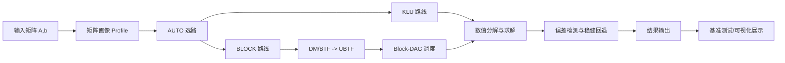

# 中国大学生计算机设计大赛

## 软件开发类作品文档

作品编号：待填写  
作品名称：Rerank——大规模稀疏线性方程组智能求解与展示系统  
作者：待填写  
版本编号：V1.0  
填写日期：2026年4月7日

---

## 目 录

第一章 需求分析  
第二章 概要设计  
第三章 详细设计  
第四章 测试报告  
第五章 安装及使用  
第六章 项目总结  
参考文献  

---

## 第一章 需求分析

大规模稀疏线性方程组求解是化工流程模拟、科学计算与工业优化中的核心基础能力。实际工程中，求解任务往往需要在牛顿迭代、参数寻优、动态仿真等场景下被重复调用，若仍采用“整体黑盒式”稀疏 LU 方案，容易出现 fill-in 增长、关键路径过长、长尾块拖慢并行效率以及病态矩阵下精度不稳定等问题。为解决上述痛点，本作品研发了 Rerank 系统，以“结构分解 + 自适应选路 + 并行调度 + 稳健回退”为主线，提升大规模稀疏矩阵求解效率，同时补充可视化展示页面，便于演示、教学与成果说明。

本作品面向的用户主要包括：

- 需要高效求解稀疏线性系统的科研人员与工程技术人员
- 数值计算、并行计算与软件工程方向的师生
- 需要快速理解系统结构、技术路线和实验结果的评审专家与演示观众

本作品的主要功能包括：

- 对输入稀疏矩阵进行结构画像与自动策略选择
- 在全局 KLU 路线与 BLOCK 分块路线间自适应切换
- 利用 DM/BTF 生成 UBTF 结构，并构建 Block-DAG 执行并行求解
- 通过异常检测与回退机制保证精度门槛
- 提供基准测试、结果汇总与项目展示页面

本作品不存在传统意义上的互联网竞品，但存在典型对标对象：一类是以 SuiteSparseWrapper/KLU 为代表的单体稀疏直接法基线，另一类是只强调更换数值后端、但缺少结构显式化与任务级调度能力的通用求解方案。本作品与对标方案对比如表 1 所示。

| 维度 | 基线方案/通用方案 | 本作品 |
| --- | --- | --- |
| 结构利用方式 | 将矩阵整体处理，结构不显式 | DM/BTF 分解后形成 UBTF 与 Block-DAG |
| 并行能力来源 | 依赖底层库内部实现，难以控制 | 块级并行 + work-stealing 调度 |
| 选路策略 | 固定流程或人工调参 | AUTO 基于画像自适应选路 |
| 稳健性 | 多依赖单一路径，解释性有限 | 风险信号检测 + 保守回退 |
| 可解释性 | 难解释“为何快/为何慢” | 可建立结构、fill-in 与耗时的证据链 |
| 展示能力 | 以命令行/报告为主 | 增加前端展示页面，适合答辩和科普 |

主要性能目标如下：

- 在保持 `err_user ≤ ε` 的前提下尽可能降低加权总耗时
- 对大权重、大规模用例取得明显加速收益
- 支持核心库独立集成，也支持比赛兼容接口与展示页面

根据现有项目报告，Final15 全部满足精度门槛，加权总耗时由 7937.462 ms 降至 3995.650 ms，整体提升约 1.99 倍。

---

## 第二章 概要设计

本作品采用“求解引擎 + 展示界面”双层架构。底层为 BlockDAGLU 稀疏求解框架，上层为项目展示页面，用于对技术路线、性能结果和材料入口进行可视化呈现。

### 2.1 总体功能模块



### 2.2 模块划分说明

| 模块 | 主要职责 |
| --- | --- |
| 输入与预处理模块 | 读取 COO/CSR 稀疏矩阵、右端项，完成基础检查 |
| 画像分析模块 | 提取规模、NNZ、块结构、长尾风险等特征 |
| AUTO 决策模块 | 根据矩阵特征在 KLU 与 BLOCK 路线之间自动切换 |
| 结构分解模块 | 执行 DM/BTF，构造 UBTF 块上三角结构 |
| 并行调度模块 | 构建 Block-DAG，利用线程池与 work-stealing 调度任务 |
| 稳健控制模块 | 监测 NaN/Inf、rcond、pivot growth、残差等信号并回退 |
| 测试统计模块 | 输出逐用例结果、加权总耗时、速度对比与汇总文件 |
| 展示界面模块 | 对项目背景、技术架构、性能结果和材料进行前端展示 |

### 2.3 层次结构与调用关系

- 展示层：负责项目介绍、结果展示、图文浏览，不参与数值求解
- 应用层：负责测试流程、案例汇总、报告展示
- 核心算法层：负责 AUTO、DM/BTF、Block-DAG、KLU/BLOCK 求解
- 支撑层：负责线程池、缓存、动态库加载、脚本化构建与运行

### 2.4 人机界面概述

本作品包含两类人机交互方式：

- 命令行交互：面向构建、运行、测试与性能复现
- 前端界面交互：面向项目展示、结果筛选、材料访问与答辩演示

其中展示界面以首页总览、技术路线、性能结果、图集与材料入口为主要页面结构，适合在竞赛答辩、教学交流及成果介绍中直接使用。

---

## 第三章 详细设计

### 3.1 界面设计

本作品新增了一个静态展示页面，路径为 `showcase/index.html`。界面围绕“项目背景、技术路线、性能结果、项目材料”四条主线展开，主要设计如下：

- 首页突出项目定位与核心结论，如“结构分解、填充控制与并行调度”
- 技术路线区展示 Input、Profile、AUTO、KLU 路线与 BLOCK 路线
- 性能结果区支持按策略类型和排序方式筛选 15 个测试用例
- 图集区整合系统流程图、算法流程图、KLU vs BLOCK 流程图、work-stealing 调度图等素材
- 材料区提供技术报告、路演稿、答辩问答、README 与架构文档入口

典型使用流程如下：

1. 用户打开展示首页，浏览项目核心指标与总体介绍
2. 用户查看技术路线，理解 DM/BTF、UBTF 和 Block-DAG 的关系
3. 用户切换到性能结果区，按 BLOCK 或 KLU 查看不同案例
4. 用户点击材料入口，打开 PDF、Markdown 或源码文件深入阅读

### 3.2 数据库设计

本作品为高性能本地求解系统，不依赖传统业务数据库，也不需要用户账号、订单、日志表等在线业务数据结构。因此本系统无关系数据库设计。

系统中主要涉及的数据组织形式如下：

| 数据类型 | 存储形式 | 说明 |
| --- | --- | --- |
| 输入矩阵 | COO / CSR / CSC | 便于结构分析与数值分解 |
| 分解结果 | UBTF 块结构、P/Q 置换、块边界 R | 支撑 BLOCK 路线 |
| 任务依赖 | Block-DAG 邻接关系 | 支撑并行调度与回代 |
| 测试结果 | CSV / summary.txt | 保存耗时、误差与汇总结果 |
| 展示内容 | HTML / CSS / JS / 图片 / Markdown / PDF | 支撑项目展示页面 |

### 3.3 关键算法与技术设计

#### 3.3.1 DM/BTF 结构分解

本作品的关键创新之一是通过 DM/BTF 将原始稀疏矩阵转换为 UBTF 形式。经过分解后，矩阵不再是单一整体，而被拆分为多个对角块和跨块上三角依赖，从结构上降低 fill-in 的扩散范围。

其意义在于：

- 将稀疏结构显式化，便于调度与分析
- 将“一个大问题”转化为“多个块 + 依赖”的组合问题
- 为块级并行提供天然任务边界

#### 3.3.2 Block-DAG 并行调度

在 UBTF 结构基础上，本作品将每个对角块抽象成图节点，跨块依赖抽象成有向边，从而形成 Block-DAG。随后利用线程池和 work-stealing 机制执行并行 factor 与 solve。

与静态并行相比，本方案具有以下优势：

- 能根据任务完成情况动态窃取任务，缓解负载不均
- 针对长尾大块可优先调度，缩短关键路径
- 避免“线程越多越慢”的常见退化

#### 3.3.3 AUTO 自适应选路

本作品不会对某个测试编号硬编码判断，而是依据矩阵的规模、NNZ、块结构、最大块比例等特征自动选择路线。

AUTO 的核心思想如下：

- 若分块收益可能显著大于构建成本，则走 BLOCK 路线
- 若矩阵更适合整体稳健求解，则走 KLU 路线
- 同时自动决定线程数上限与部分关键参数，避免人工反复调参

#### 3.3.4 稳健回退机制

本作品把数值稳定性作为硬约束处理，通过如下信号进行风险识别：

- 分解返回码异常
- NaN / Inf
- 条件数恶化或 rcond 过低
- pivot growth 异常
- 误差裕量收窄

一旦检测到风险，系统会切换到更保守参数，或回退到更稳健的单体路径，以保证最终满足精度门槛。

### 3.4 技术创新总结

本作品的技术创新主要体现在以下四点：

- 结构分解驱动求解，而不是简单调用黑盒稀疏库
- Block-DAG 与 work-stealing 相结合，提升并行利用率
- AUTO 根据画像做自适应决策，增强泛化能力
- 通过稳健回退机制平衡性能与精度

---

## 第四章 测试报告

### 4.1 测试环境

根据项目构建文档，本作品主要测试环境如下：

| 项目 | 配置 |
| --- | --- |
| 操作系统 | Windows |
| 编译工具 | Visual Studio 2022 / MSVC |
| 构建方式 | CMake 3.20+ |
| 运行依赖 | KLU、BTF、AMD、COLAMD 等动态库 |
| 数据集 | `data/FinalTestCases/1~15` |

### 4.2 主要测试内容

本作品测试重点包括：

- 功能正确性测试：能否正常完成 analyze、factor、solve
- 精度测试：是否满足 `err_user ≤ ε`
- 性能测试：加权总耗时、单用例耗时、分阶段耗时
- 并行测试：不同线程数下的变化趋势
- 稳健性测试：病态矩阵、异常数值情况下的回退表现
- 可用性测试：构建脚本、基准脚本、展示页面是否可正常使用

### 4.3 主要测试结果

根据技术报告中的决赛 Final15 统计结果，关键结果如表 2 所示。

| 指标 | 基线 / 对照 | 本作品 | 结果 |
| --- | --- | --- | --- |
| 加权总耗时 | 7937.462 ms | 3995.650 ms | 1.99x |
| Case 7 总耗时 | 4634.000 ms | 1830.190 ms | 2.532x |
| Case 9 总耗时 | 3642.620 ms | 981.908 ms | 3.710x |
| 精度门槛 | `err_user ≤ ε` | 全部满足 | 15/15 通过 |

### 4.4 典型测试分析

1. 本作品并不是所有 case 都使用 BLOCK 路线，而是通过 AUTO 按矩阵结构自适应决策。
2. 对权重大、结构适合分块的 case 4、7、9、13，BLOCK 路线提升明显。
3. 对部分结构更耦合或分块构建收益不足的用例，KLU 路线更稳妥。
4. 收益主要集中在 `decomp / factor` 阶段，说明结构分解与并行调度真正起到了作用。

### 4.5 多维度技术指标

| 维度 | 表现 |
| --- | --- |
| 运行速度 | Final15 总体约 1.99x 提升，Case 9 达到 3.710x |
| 安全性 | 本地运行，无用户隐私数据；核心依赖边界清晰，风险可控 |
| 扩展性 | 支持可插拔后端，核心算法与竞赛接口解耦 |
| 部署方便性 | 支持 CMake 构建与脚本一键运行 |
| 可用性 | 同时提供核心库、测试脚本、展示页面和技术文档 |

---

## 第五章 安装及使用

### 5.1 安装环境要求

- Windows 操作系统
- Visual Studio 2022 或 Build Tools
- CMake 3.20 及以上
- 运行时动态库已加入 PATH

### 5.2 默认安装过程

在项目根目录下执行：

```powershell
powershell -NoProfile -ExecutionPolicy Bypass -File .\scripts\build.ps1 -Config Release
```

若只构建核心库，可执行：

```powershell
powershell -NoProfile -ExecutionPolicy Bypass -File .\scripts\build.ps1 -Config Release -NoToolchain
```

### 5.3 典型使用流程

#### 方式一：运行基准测试

```powershell
powershell -NoProfile -ExecutionPolicy Bypass -File .\scripts\run_benchmark.ps1
```

运行后会在 `bench/out/<timestamp>/` 目录下生成：

- `runs.csv`
- `margin.csv`
- `summary.txt`

#### 方式二：集成为 C++ 求解库

```cpp
#include "blockdaglu/solver.h"
blockdaglu::Solver s;
s.set_matrix(std::move(A));
s.analyze();
s.factor();
s.solve_in_place(b);
```

该方式适用于将本作品作为独立求解模块接入其他工程。

#### 方式三：打开项目展示页面

展示页面位于：

- `showcase/index.html`

可直接双击打开，也可在项目目录执行：

```bash
python3 -m http.server
```

然后在浏览器访问展示页面，以查看项目介绍、技术路线、性能结果和材料入口。

### 5.4 使用说明

建议用户按照如下顺序体验本作品：

1. 先阅读展示页面或 README，了解整体设计思路
2. 再运行基准测试，查看性能汇总结果
3. 如需二次开发，可接入核心 API 或查看技术报告、源码模块

---

## 第六章 项目总结

本作品的开发过程体现了“算法设计、工程实现、可视化展示”三者结合的完整软件开发流程。项目初期，团队主要聚焦于稀疏矩阵求解中的结构性瓶颈，逐步发现单纯更换底层数值库无法稳定解决 fill-in、长尾块和关键路径问题，因此将重心转移到结构分解与调度框架设计上。随后，团队完成了 DM/BTF、UBTF、Block-DAG、AUTO、线程池与稳健回退等核心模块的逐步迭代，并通过多轮回归测试建立起从“结构变化”到“性能提升”的证据链。

在项目推进过程中，主要克服了以下困难：

- 如何在性能提升与精度门槛之间取得平衡
- 如何避免“线程越多越慢”的并行退化现象
- 如何让复杂算法方案具备可解释性与可复现性
- 如何把偏底层的求解系统转化为适合答辩展示的前端界面

通过本项目，团队在稀疏数值计算、并行编程、软件架构设计、技术文档整理与作品展示方面都获得了明显提升。后续升级方向包括：

- 进一步细化代价模型，提高 AUTO 的判别能力
- 对超大关键块继续挖掘块内并行能力
- 增强更多可插拔后端支持，拓展工程适配范围
- 持续完善展示页面，使其兼具教学、演示和成果发布价值

总体而言，本作品不仅完成了一个高性能稀疏求解系统，也形成了一套“可构建、可测试、可展示、可讲解”的完整软件成果形态。

---

## 参考文献

[1] Davis T A. Direct Methods for Sparse Linear Systems[M]. Philadelphia: SIAM, 2006.  
[2] Davis T A, Palamadai E. Algorithm 907: KLU, a Direct Sparse Solver for Circuit Simulation Problems[J]. ACM Transactions on Mathematical Software, 2011.  
[3] Pothen A, Fan C J. Computing the Block Triangular Form of a Sparse Matrix[J]. ACM Transactions on Mathematical Software, 1990.  
[4] Davis T A, Gilbert J R, Larimore S I, et al. A Column Approximate Minimum Degree Ordering Algorithm[J]. ACM Transactions on Mathematical Software, 2004.  
[5] Microsoft. CPU Sets and Processor Affinity APIs[EB/OL]. Microsoft Learn.  
[6] BlockDAGLU 项目组. 大规模稀疏线性方程组求解：结构分解、填充控制与并行调度的工程化实现[R]. 2026.
